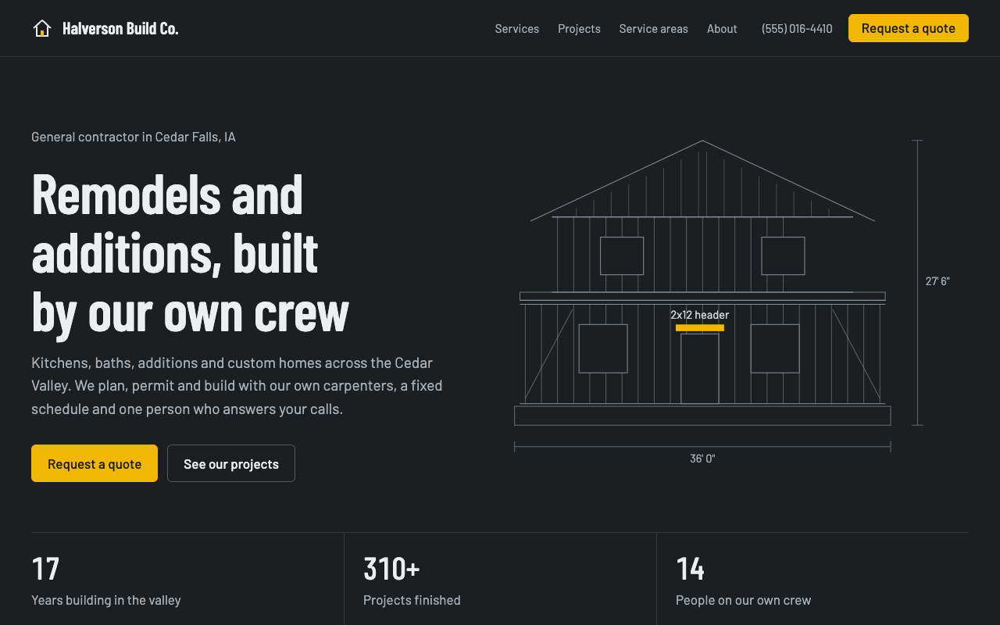

# Halverson Build Co.: construction website template

A website for a builder, remodeler or general contractor: services, projects with before and after views, how a project runs, service areas, licensing and a quote request form. Built with Astro as a fully static site.



[](https://console.cloudzyro.com/new?repo=https://github.com/Cloudzyro/template-construction)

## What's included

- Home page with a framing-plan drawing, quick facts, services, recent projects, the process, service areas and licensing
- Services page with scope and typical length and price range for each kind of work
- Project pages with an accessible before and after slider (drag it or use the arrow keys), the scope and a sample review
- Service areas page with a simple map and a list of towns
- About page with the team, licensing, insurance and warranty
- Quote request form (project type, budget range, timing, address, description) that works without a server
- Click-to-call phone number in the header and menu
- Structured data for a general contractor, Open Graph tags, sitemap, robots.txt and favicon
- Responsive down to 360px, keyboard friendly, visible focus styles and reduced motion respected
- No tracking and no third-party scripts

## Run it locally

You need Node 22.23 or newer and pnpm.

```bash
pnpm install
pnpm dev       # http://localhost:4321
pnpm build     # static site in dist/
pnpm preview   # serve the build
```

## Make it yours

- **Content:** everything lives in `src/data/site.ts`: business details, licensing and insurance, services, projects, process steps, service area towns, the About page and the quote form's options.
- **Licensing:** the license and policy numbers in the demo are placeholders. Put your real ones in `licensing` and in the footer line in `src/layouts/Base.astro`.
- **Projects:** each project has a type (`kitchen`, `bath`, `addition` or `porch`) that picks its illustration. To use your own photos, replace `src/components/ProjectArt.astro` with Astro's `<Image>` showing your before and after shots (8:5 works best).
- **Area map:** town positions for the simple map are at the top of `src/pages/areas.astro`.
- **Quote form:** set `PUBLIC_FORM_ENDPOINT` to a form service address (Formspree, Basin, a Supabase function or similar). With no endpoint set, the form shows a short note and opens the visitor's email app addressed to your `email`.
- **Site address:** set `SITE_URL` (for example `https://www.yourcompany.com`) so the sitemap, canonical links and social previews use it.
- **Colors and fonts:** the variables at the top of `src/styles/global.css`. Fonts are Barlow Condensed and Barlow, self-hosted through Fontsource.
- **Social preview image:** replace `public/og.png` (1200 x 630).

Copy `.env.example` to `.env` to set the variables locally. On Cloudzyro, add them in your site's environment settings.

## Deploy

Click the button above to make your own copy and put it online, or push your copy to GitHub and connect the repository in the Cloudzyro console. It builds with `pnpm build` and serves the static `dist/` folder.

## Stack

- [Astro](https://astro.build) 7, static output
- `@astrojs/sitemap`
- Barlow Condensed and Barlow via Fontsource
- Plain CSS and a few lines of TypeScript for the before and after slider and the form

## License

MIT, see [LICENSE](./LICENSE).
